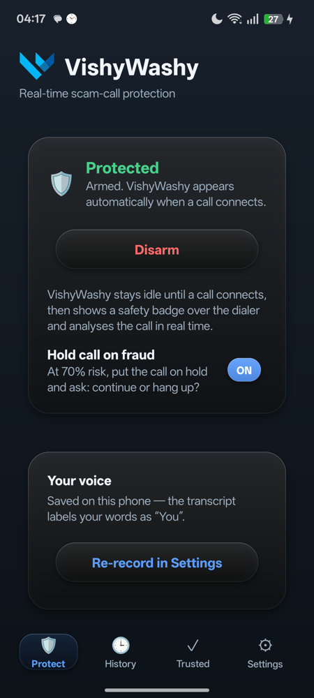
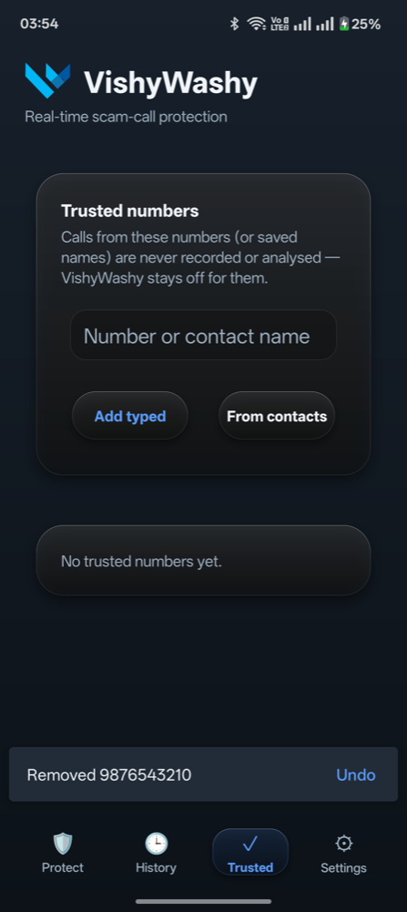
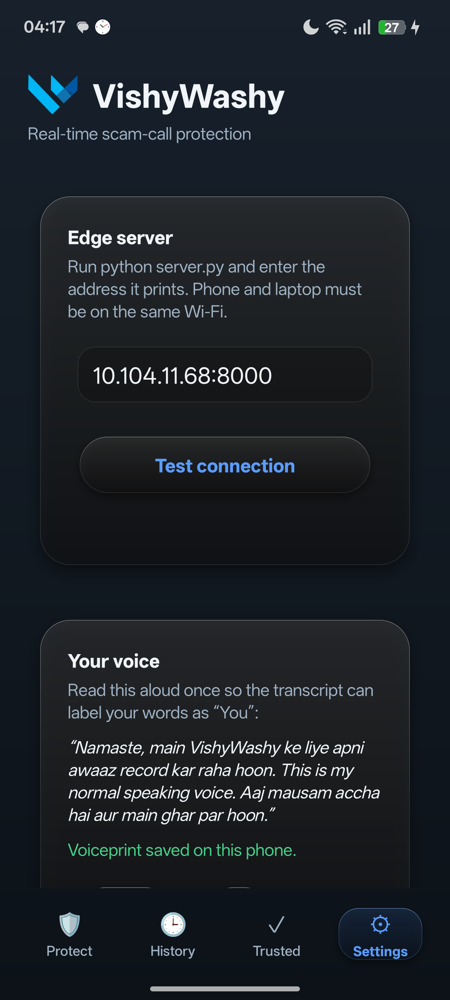
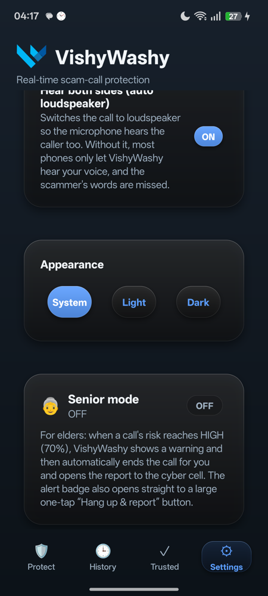
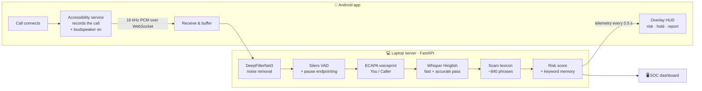

<div align="center">


# VishyWashy

**Real-time scam-call protection for Indian phone users.**
VishyWashy listens to a call as it happens, transcribes both sides in Hinglish, Hindi and English,
spots the phrases scammers use — *"OTP bataiye"*, *"aap digital arrest mein hain"*, *"AnyDesk install karo"* —
and warns you, or puts the call on hold, before you share anything.


[Features](#-features) ·
[How it works](#-how-it-works) ·
[Installation](#-installation) ·
[Configuration](#%EF%B8%8F-configuration) ·
[Troubleshooting](#-troubleshooting) ·
[Project structure](#-project-structure)

</div>

---

## ✨ Features

| | |
|---|---|
| 🛡️ **Live scam detection** | Scores every half-second of the call from what is said. A clear scam request reaches **HIGH** risk on its own. |
| 🗣️ **Hinglish speech recognition** | Whisper fine-tuned for Indian speech (Oriserve *Hindi2Hinglish*): Hindi and Hinglish come out as romanised Hinglish, English stays English. Live text while someone is still talking. |
| 📖 **~840 scam phrases** | English, romanised Hinglish and Devanagari: digital arrest, courier/parcel, KYC/bank, OTP/PIN/CVV, UPI collect & QR, remote-access apps, lottery/KBC, job/task, investment/crypto, loans, sextortion, SIM/electricity disconnection, family emergency. Sound-alike matching catches spelling variants and common mishearings. |
| 👥 **Who said what** | A 10-second voiceprint labels your words **You** and everyone else **Caller**. The caller's phrases count fully; yours count 60%. |
| 🔇 **Noise & background voices removed** | DeepFilterNet3 cleans every hop; a level gate drops distant voices without losing a quiet speakerphone caller. |
| ⏸️ **Hold call on fraud** | At 70% risk the app presses the dialer's **Hold** (or **Mute**) and asks: *continue* or *hang up*? |
| 🔊 **Hears both sides** | Switches the call to loudspeaker automatically (click, then real tap, verified after each) so the microphone hears the caller. |
| 🧓 **Senior mode** | On high risk the call is ended for you and the report is opened — one tap, no decisions. |
| 🚨 **Report to cyber cell** | After a flagged call: transcript + recording, pre-addressed to the cyber-cell number, sent by you through the share sheet. |
| ✅ **Trusted numbers** | Calls from trusted numbers or contacts are never recorded or analysed. Removing one can be undone. |
| 🕒 **History** | Every watched call with time, caller, duration, outcome and a peak-risk bar. Never any audio. |
| 📊 **SOC dashboard** | Browser console with the live risk gauge, risk timeline, colour-coded transcript (the caller's scam words highlighted), indicators and latency. |
| 🔒 **Privacy by design** | DPDP consent first. Audio lives only in server memory and is deleted 2 minutes after the call. |

<div align="center">

| Protect | Trusted | Settings | During a call |
|:---:|:---:|:---:|:---:|
|  |  |  |  |

</div>

---

## 🧠 How it works



1. **Capture.** Android only lets ordinary apps record during a call as an *accessibility service*, and
   only system apps get the call's own audio stream. VishyWashy tries that call stream first; on most
   phones it records the microphone instead and switches the call to **loudspeaker**, so the microphone
   hears the caller too.
2. **Clean & segment.** Each 0.5 s hop is denoised (DeepFilterNet3). Speech is cut at real pauses (relative
   to the speaker's level), long sentences between words, and each turn is labelled **You** or **Caller**
   against your voiceprint.
3. **Transcribe.** A fast model (*Swift*, CPU) gives text ~0.2 s after a phrase ends and live partial text
   while someone is talking; an accurate model (*Apex*, GPU) refines each line about 0.8 s later.
4. **Score.** The lexicon matches exact phrases, sound-alikes (*jayega / jaega*, *आधार / आदार*, *"any desk"*)
   and Devanagari phrases written in Latin script. Risk is

   > **R = (0.35 · intent + 0.20 · strongest keyword) / 0.55** — *MEDIUM ≥ 35%, HIGH ≥ 70%*

   where *intent* combines every distinct phrase heard. A phrase keeps counting for **30 s** after it is
   heard, then fades over 60 s, so the meter doesn't drop the moment the scammer pauses.
5. **Act.** The phone shows the risk, puts the call on hold at 70% (or hangs up in senior mode), and
   offers to report the call.

---

## 📦 Installation

You need a **laptop** for the server (macOS with Apple Silicon, Linux with CUDA, or any CPU — slower)
and one or more **Android 9+** phones on the **same Wi-Fi** (a phone hotspot works too).

### 1 · Start the server

```bash
git clone <this-repo> VishyWashy && cd VishyWashy
python3 -m venv venv
venv/bin/pip install -r requirements.txt     # first time only (downloads PyTorch)
venv/bin/python server.py
```

The first start downloads the speech models from Hugging Face (a few GB, once). When it is ready
the console prints:

```
Dashboard (this machine): http://localhost:8000
Dashboard (LAN):          http://192.168.x.y:8000
Phone app server address: 192.168.x.y:8000
```

If macOS asks whether Python may accept incoming connections, click **Allow**.

### 2 · Install the app on the phone (no USB needed)

1. On the phone, open **`http://<laptop-address>:8000/app`** in the browser.
2. Tap **Download**, open the file, and allow *install unknown apps* for the browser if asked.
3. Tap **Install** (on OnePlus/Oppo, the security scan may ask you to confirm once more).

The APK is also in [`dist/VishyWashy.apk`](dist/VishyWashy.apk). Every build is signed with the same key,
so new versions install over the old one without uninstalling.

### 3 · Set it up (one time)

Open **VishyWashy**. The **Protect** tab shows a **Finish setup** checklist; tap the button next to
each step until all are ✓:

| Step | Why |
|---|---|
| **Consent** | DPDP notice: what is recorded, for how long, and why. Nothing runs before this. |
| **Microphone** *(required)* | To hear the call. |
| **Phone & calls** | To notice calls and to hang up a scam call for you. |
| **Notifications** | To offer the report after a flagged call. |
| **Accessibility service** *(required)* | Settings › Accessibility › **VishyWashy call protection** › On. **Android 13+:** if the switch is greyed out, open **App info › ⋮ › Allow restricted settings** first. |
| **Battery** | So the phone (OnePlus, Oppo, Xiaomi…) doesn't stop protection in the background. |

Then go to **Settings › Edge server**, check the address and tap **Test connection**, and tap
**Arm protection** on the Protect tab. Optionally, **Settings › Your voice › Record** (10 s) so your
words are labelled *You*.

From then on nothing runs between calls. When a call connects — answered, dialled, or WhatsApp and
other internet calls — the badge appears and audio streams to the server; when the call ends, both stop.

### 4 · Watch on the dashboard

Open `http://localhost:8000` on the laptop. With **Auto-follow phone** ticked the dashboard switches to
a phone's call as soon as it starts; **Source** switches between sessions.

<details>
<summary><b>Build the APK from source</b></summary>

Requirements: **JDK 17** and the **Android SDK** (`android/local.properties` → `sdk.dir=…`).

```bash
cd android
./gradlew assembleDebug -PedgeHost=192.168.x.y:8000   # bakes in the default server address
cp app/build/outputs/apk/debug/app-debug.apk ../dist/VishyWashy.apk
```

The server's install page serves `dist/VishyWashy.apk`. Builds are signed with
`android/keystore/vishywashy.keystore` (a shared development key, password `android`) — use your own
release key before publishing anywhere public. Android Studio works too: open `android/` and press Run.

</details>

<details>
<summary><b>Install over USB instead</b></summary>

```bash
adb install -r dist/VishyWashy.apk
# Phone can't reach the laptop over Wi-Fi? Tunnel through the cable and use 127.0.0.1:8000 in the app:
adb reverse tcp:8000 tcp:8000
```

</details>

---

## ⚙️ Configuration

### Server (environment variables)

| Variable | Default | Description |
|---|---|---|
| `PORT` | `8000` | HTTP / WebSocket port. |
| `DHVANI_ENABLE_ASR` | `1` | `0` disables speech recognition (keyword scoring then only uses text sent by clients). |
| `DHVANI_ASR` | `hinglish` | `hinglish` (Whisper-Hindi2Hinglish, GPU when available) or `whisper` (faster-whisper Hindi/English, CPU). |
| `DHVANI_HINGLISH_MODEL` | Oriserve Apex | Hugging Face id of the accurate Hinglish model. |
| `DHVANI_ASR_BEAMS` | `1` | Beam width of the accurate pass (`4` = slightly more accurate, ~25% slower). |
| `DHVANI_WHISPER_MODEL` | `small` | faster-whisper size for `DHVANI_ASR=whisper`. |
| `DHVANI_WHISPER_LANG` | auto | Force `hi` or `en` for `DHVANI_ASR=whisper`. |
| `DHVANI_WHISPER_DEVICE` | `auto` | `cpu` / `cuda` for faster-whisper. |
| `DHVANI_HELPLINE` | `1930` | National cyber-crime helpline shown in reports. |
| `DHVANI_DEBUG_DIR` | *(off)* | Troubleshooting only: saves each call's audio and labelled transcript to this folder. |

### App (Settings tab)

| Setting | Default | Description |
|---|---|---|
| Edge server | build default | Laptop address, e.g. `192.168.1.20:8000`. **Test connection** checks it. |
| Your voice | — | 10 s recording → voiceprint kept on the phone, sent at the start of each call. |
| Hold call on fraud | On | At 70% risk, hold (or mute) the call and ask *continue / hang up*. |
| Hear both sides | On | Switch calls to loudspeaker so the caller is heard. |
| Microphone source | Auto | Leave on **Auto**. Only if the caller's words never appear on SIM calls: try **Dual**, then **Camcorder** or **Raw**. |
| Appearance | System | System / Light / Dark. |
| Senior mode | Off | On high risk, end the call automatically and open the report. |
| Report to cyber cell | fixed | Reports go to **+91 8383853196** (fixed, can't be changed in the app). |

---

## 🔒 Privacy

* **Consent first** (India's DPDP Act): nothing is captured until you agree, and **Withdraw consent** stops everything.
* **Only during calls**, only while armed, never for **trusted** numbers.
* **No audio on the phone.** The server keeps a call's audio only in memory, for **2 minutes** after the
  call — the window to tap *Report* — then deletes it. The audit log stores scores and phrase tags, never
  audio or transcript text.
* **Nothing is sent automatically.** A report opens the share sheet; you choose to send it.

---

## 🩺 Troubleshooting

<details>
<summary><b>The app says "Can't reach" the server</b></summary>

* Phone and laptop must be on the same network. Campus/office Wi-Fi often blocks devices from talking to
  each other — use a **phone hotspot**, or USB with `adb reverse tcp:8000 tcp:8000` and the address `127.0.0.1:8000`.
* Allow Python through the macOS firewall when asked.
</details>

<details>
<summary><b>Only my voice is transcribed, not the caller's</b></summary>

* The badge says **Caller not heard** when the call isn't on loudspeaker — tap it, or tap **Speaker** on the call screen.
* Keep **Hear both sides** on (Settings › During a call).
* If the caller still never appears on SIM calls on a particular phone, try **Settings › Microphone source** → **Dual**, then **Camcorder** or **Raw**.
* When testing with two phones, keep them in **different rooms** — otherwise each hears the other person through the air.
</details>

<details>
<summary><b>The accessibility switch is greyed out ("Restricted setting")</b></summary>

Android 13+ restricts apps installed from a file. Open **App info** (Settings › Apps › VishyWashy), tap
**⋮** → **Allow restricted settings**, then turn the service on. The setup checklist links there.
</details>

<details>
<summary><b>Protection stops working after a while</b></summary>

Complete the **Battery** step of the setup checklist (or Settings › Apps › VishyWashy › Battery ›
*Unrestricted*). Force-stopping the app also switches its accessibility service off — turn it on again.
</details>

---

## 🧪 Tests

```bash
venv/bin/python server.py --test   # endpointing, silence gating, latency, audit log, risk bounds, telemetry schema
venv/bin/python engine.py          # lexicon & scoring smoke test (Hindi, Hinglish, English, mishearings)
```

---

## 🗂️ Project structure

```
.
├── server.py            FastAPI server: WebSockets, sessions, endpointing, risk loop, reports, install page
├── speech.py            Speech front end: DeepFilterNet3, VAD, speaker turns (ECAPA), Hinglish Whisper
├── engine.py            Scam lexicon (~840 phrases), sound-alike matcher, risk scoring, faster-whisper backend
├── dashboard.html       Browser SOC dashboard (served at /)
├── requirements.txt     Python dependencies
├── dist/
│   └── VishyWashy.apk   Ready-to-install app (served at /app)
├── branding/            Logo (SVG + transparent PNGs) and store icon
├── docs/screenshots/    Images used in this README
└── android/             Android app (Kotlin, no XML layouts)
    ├── keystore/        Shared signing key, so every build updates in place
    └── app/src/main/java/com/vishiwashi/callguard/
        ├── HudControlActivity.kt     Main screen: Protect · History · Trusted · Settings
        ├── call/CallGuardService.kt  Accessibility service: call detection, speaker, hold, hang-up
        ├── audio/AudioStreamManager.kt  Call capture and WebSocket streaming
        ├── hud/CallHud.kt            Overlay badge / alert card during calls
        ├── consent/                  DPDP consent and the setup checklist
        ├── settings/                 Preferences, history, trusted numbers, voice enrolment
        └── ui/Neu.kt                 Glass UI toolkit (cards, buttons, animations)
```

---

## 🛠️ Built with

* **Speech:** Oriserve Whisper-Hindi2Hinglish [Apex](https://huggingface.co/Oriserve/Whisper-Hindi2Hinglish-Apex) & [Swift](https://huggingface.co/Oriserve/Whisper-Hindi2Hinglish-Swift) ·
  [faster-whisper](https://github.com/SYSTRAN/faster-whisper) (Silero VAD) ·
  [DeepFilterNet](https://github.com/Rikorose/DeepFilterNet) ·
  [SpeechBrain ECAPA-TDNN](https://speechbrain.github.io/)
* **Server:** Python · FastAPI · Uvicorn · PyTorch (MPS / CUDA / CPU) · SQLite (in-memory audit log)
* **App:** Kotlin · Android accessibility & overlay APIs · OkHttp WebSockets · Material Components
* **Dashboard:** HTML · Tailwind CSS · vanilla JavaScript

<div align="center">
<sub>Made to stop "digital arrest", KYC and OTP scams before the money moves. Report cyber fraud in India on <b>1930</b> or <a href="https://cybercrime.gov.in">cybercrime.gov.in</a>.</sub>
</div>
